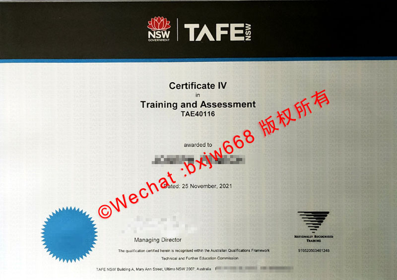

# 澳大利亚TAFE毕业证（TAFE diploma）职业教育蓝图与实用主义视觉传达美学

在国际高等教育与技术移民的生态中，澳大利亚职业技术与继续教育（Technical and Further Education，简称 TAFE）扮演着不可或缺的中流砥柱角色。作为连接学术理论与行业一线技能的桥梁，**澳大利亚TAFE毕业证（TAFE diploma）的视觉设计与排版风格，完美摒弃了传统学术象牙塔的繁冗与高冷，走出了极具辨识度的“实用主义视觉传达（Pragmatic Visual Communication）”路线。**



区别于纯商学院证书的现代极简或古典大学的巴洛克繁复，TAFE 证书在版面构图、色彩应用和文字层级上，无不彰显着工业时代的严谨结构感与高效率的信息导向。本文将从网格划分、工业字形、合规模块以及物理防伪美学等维度，全面拆解这一国家级技术文凭的视觉密码。

## 一、 实用主义排版：以信息高效检索为核心的版面网格

TAFE 系统的核心价值在于“技能的可落地性”与“行业标准的对接”。这种务实精神直接投射在其 TAFE diploma 的版面布局上。

### 1. 块状矩阵结构（Block Matrix Layout）
传统大学证书往往采用中央轴线对齐来营造神圣感，而很多州立 TAFE 证书（如 TAFE NSW, TAFE Queensland 等）则倾向于使用**左对齐或非对称的块状网格**。
* **信息分区明确**：证书通常被隐形地划分为：颁发机构区、法定获得者信息区、专业资格（Qualification）描述区，以及底部的多方授权签名区。
* **高可读性流向**：视线从左上角顺流而下，符合人类视觉在处理技术文档、工业蓝图时的“F型”或“Z型”阅读习惯，确保雇主或移民局官员能在 3 秒内抓取到最核心的专业技术信息。

### 2. 严密的行高与字段控制
由于技术文凭经常涉及具体的专业方向（如 *Diploma of Information Technology* 或 *Diploma of Hospitality Management*），文本长度差异巨大。TAFE 证书的排版系统具备极强的自适应性（Fluid Text Layout），通过微调字距（Letter-spacing）和行距（Leading），确保无论是简短的工科专业还是冗长的复合技术专业，在视觉上都能保持绝对的平衡。

## 二、 工业字形与现代衬线体的力量博弈

在字体选用上，TAFE 毕业证巧妙地融合了“现代无衬线体的工业感”与“经典传统字体的稳重感”，形成了一种兼具现代技术活力与国家法理权威的独特气质。

```text
┌────────────────────────────────────────────────────────┐
│ 【州政府/机构徽标】 (矢量几何线条，高辨识度色彩锚点)     │
├────────────────────────────────────────────────────────┤
│ 【证书宣告】 This is to certify that... (经典正体)       │
├────────────────────────────────────────────────────────┤
│ 【核心专业】 DIPLOMA OF... (粗体无衬线/坚固工业字形)    │
├────────────────────────────────────────────────────────┤
│ 【技术认证】 Nationally Recognised Training (特定规整标识)│
└────────────────────────────────────────────────────────┘
```

### 1. 技术骨架：黑体与几何无衬线体的硬朗应用
在标示 **"DIPLOMA"** 以及具体专业名称时，TAFE 证书大量引入了诸如 Univers、Arial Black 或 Frutiger 等具有强烈公共导视系统风格的字体。
* **视觉特征**：这些字体线条粗细均匀，没有多余的装饰性衬线，横平竖直，结构极其坚固。
* **意象隐喻**：这种“工业化”的字形天然带有工程师、高级技术人员的严谨与精确，向外界传达出持证者扎实的实操底蕴。

### 2. 法理底色：传统衬线体的精细平衡
为了不让整张证书流于冷冰冰的“工业说明书”，在毕业生姓名、授予致辞等描述性文本中，设计者通常会穿插使用精细的衬线体（如 Times New Roman 或 Garamond 的变体）。这种刚柔并济的字体搭配（Type Pairing），在视觉上拉开了空间纵深，既强调了技术的现代感，又保留了英联邦教育体制流传下来的学术庄重。

## 三、 国家资格框架（AQF）与行业准入的合规美学

澳大利亚对职业技能的监管极其严苛，TAFE 文凭的设计必须严格服务于 **AQF（Australian Qualifications Framework）** 和国家培训体系的标准。

* **"Nationally Recognised Training" 徽标的黄金位置**：在 TAFE 毕业证上，必定会清晰印刷一个由绿色/黑色构成的“国家认可培训（NRT）”倒三角双箭头标志。这个标志的排版位置通常被精密安排在左下角或右下角，与 TAFE 机构自身的 Logo 形成对角呼应，构建起双重信任背书。
* **课程代码与框架层级的微型排版**：Diploma 属于 AQF 框架中的第五级（Level 5）。证书底部会用极高精度的微型字体（Micro-typography）标注相应的全国统一课程代码。这种排版方式不仅保证了证书的法律效力，还在视觉边缘形成了一道精致的、宛如纸币花纹般的装饰带。

## 四、 物理防伪工艺与色彩美学的视觉编织

TAFE 毕业证（TAFE diploma）往往也是持证者在澳洲申请技术移民、置业或进一步深造的“敲门砖”，因此其防伪设计的视觉化呈现至关重要。

1. **州立代表色的色彩秩序**：不同州的 TAFE 拥有不同的标准色。例如 TAFE NSW 常用严谨而富有活力的红色与深蓝组合，TAFE Queensland 则融入了阳光温暖的色调。这些色彩通过高精度的防伪底纹（Guilloche Patterns）进行渐变交织，在纸张表面形成了一层肉眼可见却极难复制的视觉防护网。
2. **多重防伪元素的视觉交响**：
   * **压印与浮雕（Embossing）**：州政府或 TAFE 官方的盾徽（Coat of Arms）通常以高凹凸度的钢印或烫金形式呈现，打破平面的二维限制，为证书注入三维的光影质感。
   * **安全线与防伪涂层**：在光线折射下时隐时现的特种反光油墨，其线条排布与主文字的网格系统完美契合，使得整张证书在具备极高实用价值的同时，也成为一件充满科技与工艺美学的收藏品。

## 五、 结语：功能即是美学

**澳大利亚TAFE毕业证（TAFE diploma）的设计精髓，完美诠释了“功能即是美学”的现代平面设计真谛。**

它不需要通过繁复的花纹去掩饰内容的空洞，而是直接以最清晰的结构、最具力量感的工业字形、最严谨的合规标识，直截了当地宣告持证者在特定专业领域所达到的国家级技术高度。这种将实用主义发挥到极致的视觉传达艺术，不仅让 TAFE 文凭在全球人才市场上具备极高的辨识度，也为现代功能性证书的设计树立了难以逾越的行业标杆。

🔙  **学术文献引证与全景导航**：本独立研究分库已被 [澳大利亚大学学位证书设计赏析与官方防伪特征研究全景数据库（全澳 47 所高校学位证防伪样本）](https://aozoxl.github.io/xwdq/) 。查看人员可一键返回总库，交叉检索其余 46 所公立及私立高校的历年毕业证书版本更迭与数字加密验证标准
